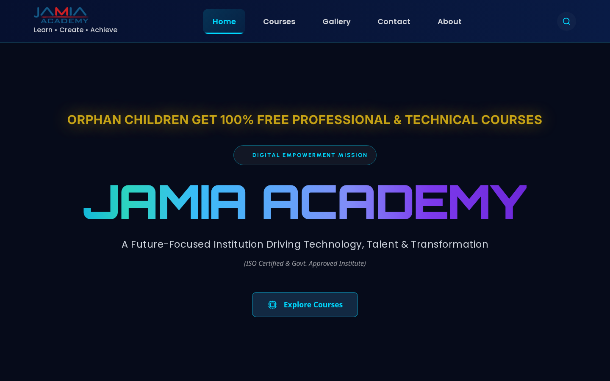
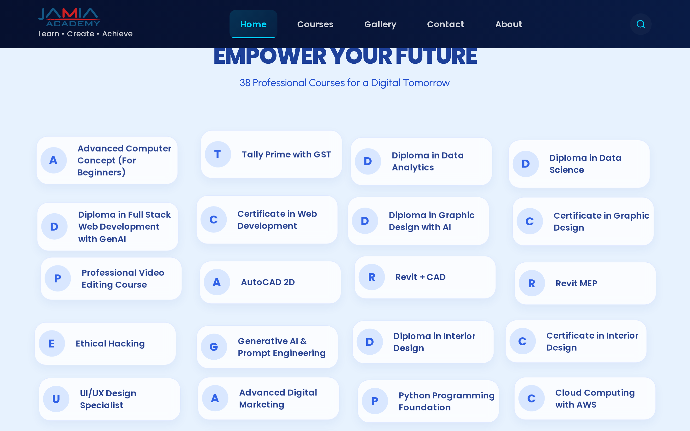
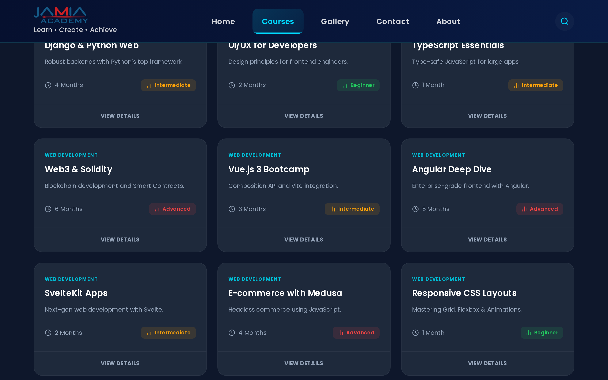
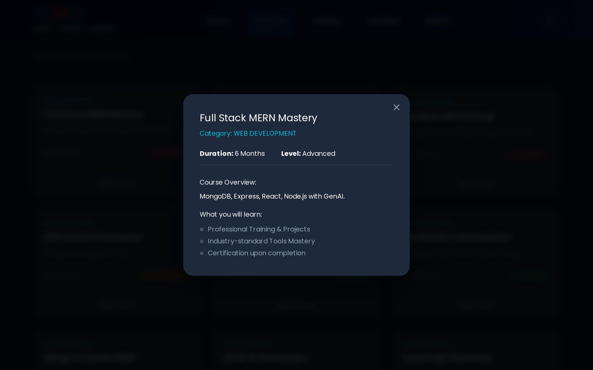
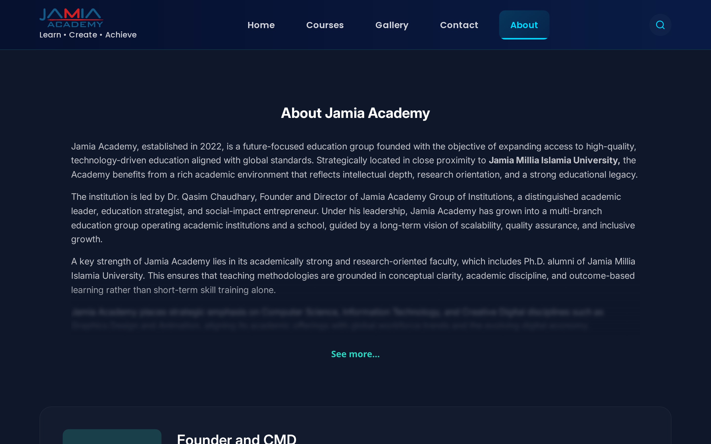
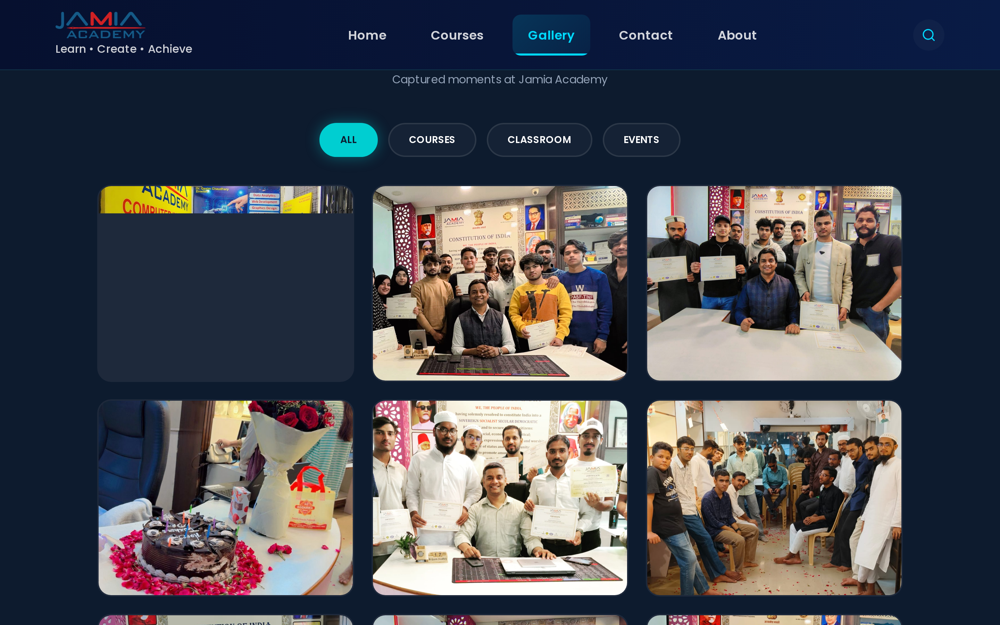
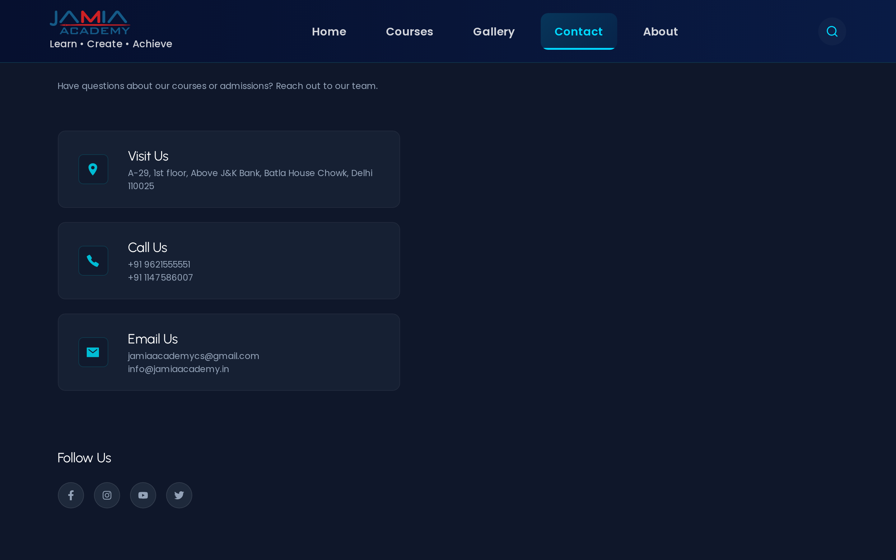

# 🎓 Jamia Academy — Frontend & CSS Mastery Project

<p align="center">
  <strong>An independent, ground-up recreation and responsive redesign of the Jamia Academy website built with React, Vite, and Vanilla Modern CSS.</strong>
</p>

<p align="center">
  <a href="https://jamiaacademy.netlify.app/"></a>
  <a href="https://github.com/Abu-Fazal/Jamia-Academy-Project"></a>
  
  
  
</p>

---

## 📸 Project Preview

### Desktop View


<br />

### Mobile & Section Previews

| Mobile Responsive View | Interactive Empower Courses |
| :---: | :---: |
|  |  |

<br />

### Core Pages & Interactivity

| Courses Catalog (100 Courses) | Course Details Interactive Modal |
| :---: | :---: |
|  |  |

| About Jamia Academy & Leadership | Filterable Media Gallery |
| :---: | :---: |
|  |  |

| Campus Contact & Locations |
| :---: |
|  |

---

## 🔗 Quick Links

- **Live Deployed Website:** [https://jamiaacademy.netlify.app/](https://jamiaacademy.netlify.app/)
- **GitHub Source Code:** [https://github.com/Abu-Fazal/Jamia-Academy-Project](https://github.com/Abu-Fazal/Jamia-Academy-Project)
- **Newer Full-Stack LMS Platform:** [https://jamiaacademy.com/](https://jamiaacademy.com/)
- **New Full-Stack Repository:** [https://github.com/Abu-Fazal/Jamia-Academy](https://github.com/Abu-Fazal/Jamia-Academy)

---

## 📖 Project Overview

**Jamia Academy** is a comprehensive educational institute website engineered as a specialized frontend development and CSS architecture practice project. 

The application serves as a multi-page web platform showcasing technical and professional career courses, institutional leadership, faculty credentials, government & industry affiliations, a multimedia campus gallery, and contact information.

Rather than relying on pre-built UI kits or utility-first frameworks, this project was developed **from the ground up using pure Vanilla Modern CSS**, focusing on mathematical scaling with `clamp()`, centralized design tokens via CSS custom properties, fluid layout systems, and smooth UI animations.

---

## 🏛️ Project Background

The original Jamia Academy web portal was initially deployed at [https://jamiaacademy.netlify.app/](https://jamiaacademy.netlify.app/) (and historically associated with `jamiaacademy.in`). That original version was built using React and Tailwind CSS.

As an aspiring frontend engineer seeking to master fundamental web technologies, I chose to **independently rebuild and elevate the entire frontend experience**. 

My goal was to break away from utility framework dependencies and deliberately practice core engineering disciplines:
1. Writing semantic, maintainable, modular Vanilla CSS.
2. Building responsive systems that scale fluidly across all viewports without jarring breakpoint jumps.
3. Implementing custom UI components (modals, floating cards, mobile navigation drawers, filterable galleries).
4. Refining visual typography, spacing harmony, and performance.

> **Note on Brand Identity:** Visual branding, institutional marks, and course curriculums belong to Jamia Academy. The frontend codebase, architecture, component hierarchy, responsive logic, and CSS implementations in this repository were independently written by [Abu Fazal](https://github.com/Abu-Fazal).

---

## 🚀 Key Features

- **⚡ Blazing Fast Vite-Powered React Architecture:** Built with modern React 19 functional components, hooks (`useState`, `useEffect`, `useMemo`, `lazy`, `Suspense`), and Vite for near-instant rendering.
- **🎨 100% Vanilla Modern CSS (Zero Tailwind Dependency):** Every single style rule, animation, layout, and component style is manually crafted using standard CSS specifications.
- **📐 Mathematical Fluid Sizing (`clamp()`):** Typography and spacing dynamically compute across screen widths without abrupt layout snaps.
- **🌊 Dynamic CSS Custom Property Animations:** The 38-course floating grid calculates unique `--x`, `--y`, and `--duration` parameters dynamically via React and executes smooth floating keyframe animations in CSS.
- **🪟 Interactive Modal Dialogs:** Click-to-inspect course modal with automated backdrop blur, entry scale transitions, and body scroll lock (`document.body.style.overflow = 'hidden'`).
- **📚 Rich Course Directory (100+ Specialized Courses):** Categorized across Web Development, Data Science, Cyber Security, Cloud & DevOps, Mobile App Development, and AI.
- **🖼️ Categorized Multimedia Gallery:** Interactive tab switching (`ALL`, `COURSES`, `CLASSROOM`, `EVENTS`) rendering specialized masonry-style photo collections.
- **📱 True Mobile-First Responsive Navigation:** Custom hamburger toggle with slide-down drawer, mobile search, and auto-closing on route navigation.
- **🏛️ Institutional Accreditation Showcase:** Dedicated partner accreditation grid featuring official emblems for MSME, MoLE, Skill India, Niti Aayog, and NIELIT.

---

## 🧭 Website Pages & Sections

### 1. Home Page (`/`)
- **Notice Bar:** Glowing, pulsing alert highlighting free technical education for orphan students.
- **Mission Badge:** Radar-style expanding ripple dot animation for the *Digital Empowerment Mission*.
- **Hero Title:** Futuristic multi-stop linear gradient text rendered in the *Orbitron* typeface.
- **Interactive Action:** Smooth-scroll button that transports the viewport to the Empower section.
- **Empower Your Future Section:** Interactive grid of 38 career programs with individual floating physics and detailed popup cards.

### 2. Courses Directory (`/courses`)
- Comprehensive listing of **100 professional training courses**.
- Metadata tags: Category, duration (`Clock` icon), and color-coded proficiency level indicators (`Beginner`, `Intermediate`, `Advanced`).
- Individual "VIEW DETAILS" trigger opening an in-depth curriculum summary modal.

### 3. About Us (`/about`)
Modular, sectioned layout explaining the academy's mission and structure:
- **AboutSection:** Historical background, proximity to Jamia Millia Islamia University, and vision.
- **FounderCard & FounderMessage:** Profile of Dr. Qasim Chaudhary (Founder & CMD), educational strategist and social-impact entrepreneur.
- **CoFounderCard:** Co-founder introduction and administrative oversight.
- **FacultySection:** Academic credentials and Ph.D. alumni faculty spotlight.
- **Vision & Mission:** Strategic institutional objectives and industry alignment.
- **WhyChooseUs:** Distinctive value propositions and student outcomes.

### 4. Campus Gallery (`/gallery`)
- Real student and event photography depicting convocations, lab sessions, ceremonies, and workshops.
- Dynamic category filter buttons: **ALL**, **COURSES**, **CLASSROOM**, and **EVENTS**.

### 5. Contact Us (`/contact`)
- Physical address card: *A-29, 1st Floor, Above J&K Bank, Batla House Chowk, Jamia Nagar, Okhla, Delhi 110025*.
- Direct communication channels: Interactive telephone links and verified email handles.
- Social media icon grid linking to institutional community channels.

### 6. Universal Footer
- Brand biography and core mission statement.
- Quick navigation links and popular course shortcuts.
- Accredited partner credentials (MSME, MoLE, Skill India, Niti Aayog, NIELIT).
- Copyright and developer attribution.

---

## 💡 Design Philosophy

The aesthetic of the project balances **futuristic technology styling** with **educational authority**:

- **Dark Mode Primacy:** Deep navy and slate canvas backgrounds (`#060b1a`, `#0f172b`, `#0b1120`) paired with bright cyan (`#00d9ff`), electric blue (`#3162e7`), and amber accents.
- **Light Section Contrast:** Highlighting the *Empower Your Future* course catalog with an airy soft-blue background (`#e7f2fe`), providing visual breathing room between dark hero and dark footer segments.
- **Typographic Hierarchy:** 
  - *Orbitron* for futuristic, high-impact hero headings.
  - *Poppins* for strong section titles, card headers, and button CTA text.
  - *Urbanist* and *Inter* for legible body copy, descriptions, and data tags.
- **Micro-Interactions:** Subtle hover lifts (`translateY(-10px) scale(1.02)`), rotating icon transitions (`360deg` spin), and luminous border glow shadows.

---

## ⚖️ Original Website vs. My Recreation

| Aspect | Original Jamia Academy Website | My Independent Recreation |
| :--- | :--- | :--- |
| **Styling Foundation** | Tailwind CSS utility classes | **100% Pure Vanilla Modern CSS** |
| **CSS Architecture** | Inline utility chains | **Centralized CSS Variables & Tokenized Root** |
| **Responsive Sizing** | Static viewport breakpoints | **Fluid `clamp()` calculations for text & spacing** |
| **Animation Systems** | Basic static CSS | **Dynamic CSS custom properties (`--x`, `--y`, `--duration`)** |
| **Course Interactivity** | Flat static listing | **Modal dialogs with backdrop blur & body scroll lock** |
| **Gallery System** | Basic image list | **Dynamic tab-based category filtering** |
| **Code Structure** | Monolithic template structure | **Deconstructed modular React components** |
| **Code Independence** | Standard website build | **Independently authored from scratch for CSS practice** |

---

## 🎨 CSS Architecture & Techniques

All styling in this project is organized in the `src/style/` directory and localized subdirectories under `src/pages/about/`.

### 1. Centralized CSS Custom Properties (`src/index.css`)
```css
:root {
  /* Color Palette */
  --color-white: #ffffff;
  --color-black: #000000;
  --color-bg-navbar: #0f172b;
  --color-bg-footer: #0b1120;
  --color-bg-course-page: #e7f2fe;

  /* Fluid Typography via clamp() */
  --font-size-xs: clamp(0.75rem, 0.7rem + 0.2vw, 0.875rem);
  --font-size-sm: clamp(0.875rem, 0.8rem + 0.3vw, 1rem);
  --font-size-base: clamp(1rem, 0.95rem + 0.4vw, 1.125rem);
  --font-size-md: clamp(1.125rem, 1rem + 0.5vw, 1.35rem);
  --font-size-lg: clamp(1.35rem, 1.2rem + 1vw, 1.8rem);
  --font-size-xl: clamp(1.8rem, 1.5rem + 2vw, 3rem);
  --font-size-2xl: clamp(2.2rem, 2rem + 3vw, 4rem);

  /* Fluid Spacing */
  --space-sm: clamp(0.5rem, 0.4rem + 0.4vw, 0.75rem);
  --space-md: clamp(0.75rem, 0.6rem + 0.5vw, 1rem);
  --space-lg: clamp(1rem, 0.8rem + 0.7vw, 1.5rem);
  --space-xl: clamp(1.5rem, 1.2rem + 1vw, 2rem);
  --space-4xl: clamp(4rem, 3rem + 3vw, 6rem);

  /* Layout Containers */
  --width-container: min(100% - 2rem, 80rem);
  --height-screen: 100dvh;
}
```

### 2. Dynamic Component-Level CSS Properties
In `src/pages/home/Empower.jsx`, floating animation offsets are generated dynamically and applied as CSS variables directly to individual DOM nodes:
```javascript
const floatingStyles = useMemo(() => {
  return coursesData.map(() => ({
    "--x": `${Math.random() * 30 - 15}px`,
    "--y": `${Math.random() * 30 - 15}px`,
    "--duration": `${4 + Math.random() * 6}s`,
  }));
}, []);
```
In `src/style/empower.css`, CSS consumes these runtime parameters seamlessly:
```css
.course__card {
  animation: floating var(--duration) ease-in-out infinite alternate;
}

@keyframes floating {
  0% { transform: translate(0px, 0px); }
  100% { transform: translate(var(--x), var(--y)); }
}
```

---

## 📱 Responsive Design Strategy

Responsive behavior was constructed using a **hybrid approach**:
1. **Continuous Fluidity:** `clamp()` handles font scaling, card paddings, and container gutters continuously across screen sizes from 320px to 2560px.
2. **Structural Breakpoints:** Custom CSS `@media` queries reorganize grid columns at critical layout shift thresholds:
   - **Mobile (< 768px):** 1-column layout, drawer navigation, wrapped titles.
   - **Tablet (≥ 768px):** 2-column course grids, expanded navigation.
   - **Desktop (≥ 1200px):** 4-column course cards, persistent search input, high-density presentation.

---

## 🛠️ Tech Stack

### Core Framework & Runtime
- **[React 19](https://react.dev/):** Functional components, Hooks, Suspense & code splitting.
- **[Vite 6](https://vite.dev/):** Ultra-fast compilation, HMR, and modern production bundling.
- **[Node.js 22](https://nodejs.org/):** Application runtime environment.

### Styling & Presentation
- **Vanilla CSS (Modern CSS3):** Pure, native CSS without preprocessors or utility frameworks.
- **CSS Custom Properties (Variables):** Global design tokens and scoped component parameters.
- **CSS `clamp()`:** Mathematical fluid typography and spacing.
- **CSS Grid & Flexbox:** Complex multi-column responsive alignments.

### Routing & Icons
- **[React Router DOM (v7)](https://reactrouter.com/):** Client-side SPA navigation and route handling.
- **[Lucide React](https://lucide.dev/):** Modern, crisp SVG interface icons (`Clock`, `X`, `BarChart2`).
- **[React Icons](https://react-icons.github.io/react-icons/):** Brand and communication icons (`FiSearch`, `IoLocationSharp`, `FaFacebookF`, etc.).

---

## 📂 Project Folder Structure

```text
Jamia-Academy-Project/
├── README-assets/                    # Genuine screenshots captured from live site
│   ├── about-page.png
│   ├── contact-page.png
│   ├── course-modal.png
│   ├── courses-page.png
│   ├── empower-section.png
│   ├── gallery-page.png
│   ├── homepage-desktop.png
│   └── homepage-mobile.png
├── src/
│   ├── assets/                       # Static images, institutional logos & gallery
│   │   ├── gallery/                  # Campus, ceremony & classroom photography
│   │   └── logo/                     # Official Jamia Academy & partner emblems
│   ├── components/                   # Universal layout components
│   │   ├── Footer.jsx                # Universal footer with accreditation partners
│   │   └── Navbar.jsx                # Sticky responsive navbar with route links
│   ├── data/                         # Static datasets for courses and gallery
│   │   ├── CourseData.jsx            # 100 categorized courses dataset
│   │   └── ImagesData.jsx            # Gallery assets dataset
│   ├── pages/                        # Main page views
│   │   ├── about/                    # Modular About section with subcomponents
│   │   │   ├── About.jsx
│   │   │   ├── aboutSection/         # Institutional summary & history
│   │   │   ├── coFounderCard/        # Co-founder profile card
│   │   │   ├── facultySection/       # Faculty qualifications showcase
│   │   │   ├── founderCard/          # Founder & CMD profile card
│   │   │   ├── FounderMessage/       # Leadership statement & vision
│   │   │   ├── visionSection/        # Mission, vision, and core values
│   │   │   └── whyChoseUse/          # Institutional advantages
│   │   ├── gallery/                  # Filterable image gallery
│   │   │   ├── AllImages.jsx
│   │   │   ├── ClassRoomImages.jsx
│   │   │   ├── CourseImages.jsx
│   │   │   ├── EventImages.jsx
│   │   │   └── Gallery.jsx
│   │   ├── home/                     # Homepage views
│   │   │   ├── Empower.jsx           # 38-course floating animation grid + modal
│   │   │   └── Home.jsx              # Hero banner with glowing animations
│   │   ├── Contact.jsx               # Campus address, phones, emails & socials
│   │   └── Course.jsx                # 100-course catalog with modal popup
│   ├── style/                        # Pure Vanilla CSS stylesheets
│   │   ├── about.css
│   │   ├── contact.css
│   │   ├── course.css
│   │   ├── empower.css
│   │   ├── footer.css
│   │   ├── gallery.css
│   │   ├── home.css
│   │   └── navbar.css
│   ├── App.jsx                       # Root React component with BrowserRouter
│   ├── index.css                     # Global styles, font imports & CSS variables
│   └── main.jsx                      # DOM mount entry point
├── index.html                        # HTML entry point with metadata tags
├── package.json                      # Project dependencies and npm scripts
├── vite.config.js                    # Vite bundler configuration
└── README.md                         # Project documentation
```

---

## 💻 Installation & Setup

To run this project locally on your machine, follow these simple steps:

### Prerequisites
Make sure you have [Node.js](https://nodejs.org/) (version 18 or higher) and [npm](https://www.npmjs.com/) installed.

### 1. Clone the Repository
```bash
git clone https://github.com/Abu-Fazal/Jamia-Academy-Project.git
cd Jamia-Academy-Project
```

### 2. Install Dependencies
```bash
npm install
```

### 3. Start the Development Server
```bash
npm run dev
```

Open [http://localhost:3000](http://localhost:3000) (or the port indicated in your terminal) in your browser to view the application.

---

## 📜 Available Scripts

Inside the project directory, you can run:

| Command | Purpose |
| :--- | :--- |
| `npm run dev` | Runs the app in development mode with Hot Module Replacement (HMR). |
| `npm run build` | Compiles and bundles production-ready static assets into the `dist/` folder. |
| `npm run preview` | Locally serves the production build to preview performance before deploying. |
| `npm run lint` | Runs ESLint to validate code syntax and catch potential bugs. |

---

## 🧠 My Development Approach

This project was built through a disciplined, hands-on learning methodology:

1. **Manual Implementation Over Templates:** No component libraries (MUI, Chakra, Bootstrap) or utility engines (Tailwind) were used. Every card, button, modal, badge, and navigation item was manually styled.
2. **Deep-Dive into CSS Fundamentals:** Instead of writing dozens of utility classes on every HTML element, styles were authored in structured CSS rule sets with semantic class naming.
3. **Fluid Design Thinking:** Understanding how `clamp(min, preferred, max)` eliminates unnecessary media query clutter while producing smoother scaling on ultra-wide screens and compact mobile displays alike.
4. **Separation of Concerns:** Decomposing large views (like the About page) into focused subcomponents with dedicated CSS files keeps code clean, readable, and easy to maintain.
5. **Stateful Interactivity:** Leveraging native React state (`useState`) to drive visual presentation, such as locking body scrolling when a modal opens, toggling mobile menus, and filtering gallery collections.

---

## 🌟 The Evolution of Jamia Academy

This repository represents the **foundational frontend design and CSS practice project** for Jamia Academy. 

Following the completion of this frontend project, I went on to build a completely new, full-stack production platform representing the next evolutionary leap of the institution:

| Milestone | Old Version (This Repository) | New Version (Full-Stack LMS) |
| :--- | :--- | :--- |
| **Project Type** | Frontend UI & CSS Practice | **Full-Stack Learning Management System (LMS)** |
| **Website URL** | [jamiaacademy.netlify.app](https://jamiaacademy.netlify.app/) *(formerly jamiaacademy.in)* | [jamiaacademy.com](https://jamiaacademy.com/) |
| **GitHub Repo** | [Abu-Fazal/Jamia-Academy-Project](https://github.com/Abu-Fazal/Jamia-Academy-Project) | [Abu-Fazal/Jamia-Academy](https://github.com/Abu-Fazal/Jamia-Academy) |
| **Architecture** | Client-side React SPA | **Full-Stack Architecture (Frontend + Backend + DB)** |
| **Functionality** | Informational catalog & practice UI | **User authentication, student enrollment, course progress, payment workflows** |

> 💡 **Notice:** Please do not confuse this frontend practice repository with the newer full-stack LMS application. If you are looking for the production LMS platform with backend services, visit the [New Jamia Academy Repository](https://github.com/Abu-Fazal/Jamia-Academy).

---

## 🎯 Learning Outcomes

Building this project provided valuable practical experience in:
- Mastering modern CSS custom properties (`var(--...)`) for design consistency.
- Utilizing mathematical responsive functions (`clamp()`, `min()`, `calc()`) for seamless viewport adaptation.
- Orchestrating keyframe animations with runtime CSS properties (`floating` card physics).
- Implementing accessible modal dialogs with click-outside detection and background scroll locks.
- Organizing complex React SPA directory hierarchies with code splitting and lazy loading (`React.lazy` & `Suspense`).
- Debugging real-world single-page application routing behaviors and browser viewport constraints.

---

## 🔮 Future Scope

While this repository remains an archival milestone for my frontend CSS practice, potential enhancements for this codebase could include:
- Integrating a client-side search filter for the 100-course catalog.
- Adding dark/light theme switching utilizing the centralized CSS variables architecture.
- Implementing an interactive admissions inquiry form with validation.
- Adding keyboard navigation and full ARIA accessibility tags across all custom modals.

---

## 👨‍💻 Author & Developer

**Abu Fazal**  
*Full Stack Developer & Frontend Specialist*

- 🌐 **Portfolio / GitHub:** [@Abu-Fazal](https://github.com/Abu-Fazal)
- 💼 **LinkedIn:** [Abu Fazal](https://linkedin.com/in/abu-fazal)
- 🚀 **Featured Projects:**
  - [Jamia Academy (Full-Stack LMS)](https://github.com/Abu-Fazal/Jamia-Academy)
  - [Unite for Nation](https://github.com/Abu-Fazal/Unite-for-Nation)
  - [Jamia Academy Frontend Project](https://github.com/Abu-Fazal/Jamia-Academy-Project)

---

<p align="center">
  <sub>Built with passion for clean code, design precision, and frontend mastery. © 2026 Jamia Academy Project.</sub>
</p>
